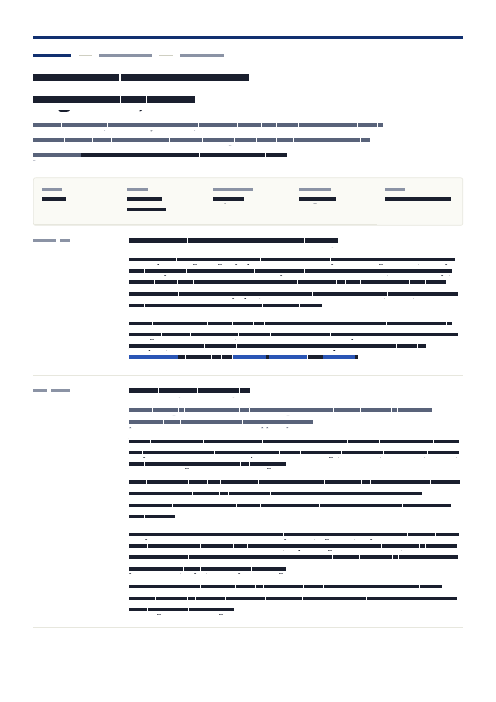
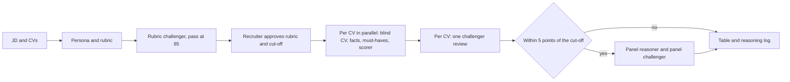

# hr-hiring

*Two Claude skills for hiring: one writes a researched job description in the company's house layout, the other screens CVs against any JD and records the reasoning behind every decision.*



It runs in the Claude desktop app, Cowork and Claude Code. Version 0.4.0 passes both test suites and was last changed on 15 October 2026. The first command after installing is one line:

```
/hr-hiring:jd-builder Customer Success Manager, Pune, must know HubSpot
```

> Maintainers changing the rules, layout or scripts can go straight to [For maintainers](#for-maintainers).

## The two skills

Each run keeps its files in a run folder: `~/JD-Builder/jd-runs/` or `~/JD-Builder/screen-runs/`, or the workspace folder in Cowork.

| Skill | Input | Output | When it asks you |
|---|---|---|---|
| `/hr-hiring:jd-builder` | A role in your own words, from one line to pages of notes | A `.docx` JD in the house layout with fonts embedded | When the role is unclear, or when research or format review cannot reach its pass mark |
| `/hr-hiring:resume-screener` | A JD (file or pasted text) and CVs (folder, several files or a zip) | A table of score, go/no-go, why proceed, why not and comments, plus a reasoning log | To approve the rubric and cut-off, and to review the final table |

## Key features

- **Each JD starts from fresh research.** The researcher opens at least 15 sources, most from the last 18 months, and a challenger playing the VP of that function must score the research 95 out of 100.
- **Anything you name appears in the JD.** The validator, a script that checks every draft, fails a draft that drops a tool, skill, city or experience range you stated.
- **The writing is checked for machine patterns.** The validator rejects em dashes, "not X, Y" contrasts, rhetorical questions, pay terms and US spellings.
- **Each CV is judged on its own.** A scorer and an independent challenger must quote the CV for every point, and invented quotes are rejected.
- **Every screening decision can be traced.** Scripts compute every total, and each run writes `reasoning.md`, a log of the rubric, must-have calls, criterion scores with reasons, and overrides.

## Installation

Python 3 must be installed on the laptop. The JD skill also needs web access for its research.

### Claude desktop app or Cowork

Open the plugin settings, add the marketplace `rishabhrawat-os/hiring`, and install **hr-hiring**. If the repository is private, the GitHub account connected to Claude needs read access to it.

### Claude Code

```
/plugin marketplace add rishabhrawat-os/hiring
/plugin install hr-hiring@onsurity-hiring
/plugin marketplace update onsurity-hiring
```

These commands were not run for this README, because they need a Claude client with plugin support. The third one fetches later updates. The Python packages the skills need (listed in [`requirements.txt`](plugins/hr-hiring/requirements.txt)) install automatically the next time Claude starts, into `~/JD-Builder/.venv` when your Python refuses user installs.

## Quickstart

1. Write a JD by naming the role and anything that must be in it: `/hr-hiring:jd-builder Data Analyst, 3 years, SQL and Power BI`.
2. Open the `.docx` the skill names at the end, in `~/JD-Builder/jd-runs/`.
3. Screen CVs by running `/hr-hiring:resume-screener` and giving it the JD file and a folder such as `~/Downloads/cvs/`.
4. Approve or edit the rubric and set the cut-off when the screener shows it.
5. Read the table, then open `reasoning.md` in `~/JD-Builder/screen-runs/<date>-<role>/` for any decision you want to check.

## How a JD is built

Seven agents run in turn, from research through a VP challenger and a humanizer pass to the rendered Word file; the [jd-builder SKILL.md](plugins/hr-hiring/skills/jd-builder/SKILL.md) lists them. Company details come only from [`company.json`](plugins/hr-hiring/skills/jd-builder/company/company.json), and a JD never states salary, because the layout has no block for it.

## How CVs are screened



- The persona is a hiring manager about 5 years more experienced than the top of the role's range, built fresh from each JD.
- Role fit carries at least 50 of the rubric's 100 points. The rest weighs these career signals:
  - stability, judged in context;
  - industry relevance;
  - breadth and depth;
  - achievements;
  - progression;
  - recency;
  - CV consistency.
- Company and college background is capped at 10 points and shown as a comment.
- Personal details are removed before scoring, and career gaps are never scored.

## Runtime and cost

A demo screen of 5 invented CVs took 4 min 22 s and 11 agent runs in October 2026. A screen uses about two agent runs per CV plus two for the rubric, with at most 8 CVs scored at once, and each agent run uses your Claude plan.

## Safety and responsible use

- CVs and results stay in the run folder, and the screener asks whether to delete them at the end.
- Candidates are scored only on their CV, with no outside lookups about people.
- A go/no-go is a first-round screen; the recruiter can override it, and the reason is logged.

## Troubleshooting

| Symptom | Cause | Fix |
|---|---|---|
| The JD run stops at research and reports that pages cannot be opened | The environment blocks web pages | Allow web access in the environment's network settings, or run on a laptop |
| A skill reports that `python-docx` or `pypdf` is missing | The automatic install at start-up failed | Run `python3 ~/.claude/plugins/.../hr-hiring/scripts/ensure_deps.py` and send its message to IT if it fails again |
| A CV shows `needs_manual_read` | The PDF is a scan with no text layer | No action is needed, because the extractor reads the original file |

## For maintainers

Two test commands run before every commit (page counts need LibreOffice and `pdfinfo`, import checks need `pdfplumber`):

```
$ bash evals/jd-builder/run_checks.sh
ok   layout-max (7 pages)
ok   layout-min (5 pages)
ok   writing checks (33 cases)
ok   fixed text follows the writing rules
ok   gate checks (13 cases)
ok   import sde-1
ok   import sde-2
ok   import sde-3
ALL PASS
$ python3 evals/resume-screener/test_scripts.py | tail -1
ALL PASS
```

The second command runs 27 checks on invented CVs; [evals/jd-builder/README.md](evals/jd-builder/README.md) explains the first. A test file (`bad.json`, made from `evals/jd-builder/fixtures/layout-min.json` with one sentence changed) fails like this:

```
$ python3 plugins/hr-hiring/skills/jd-builder/scripts/validate_jd.py bad.json
FAIL writing: em dash: '...We ship fast — every week, not just on Frida...'
FAIL writing: 'not just / not only' contrast: '...We ship fast — every week, not just on Fridays....'
{"file": "bad.json", "pass": false, "problems": 2}
```

Paths in the Edit column are inside `plugins/hr-hiring/skills/`; the commands run from the repository root.

| To change | Edit | Then run |
|---|---|---|
| Company details, market, default city | `jd-builder/company/company.json` | `bash evals/jd-builder/run_checks.sh` |
| JD layout, colours or fonts | `jd-builder/brand/tokens.json` and `jd-builder/brand/design-spec.md` | `bash evals/jd-builder/run_checks.sh` |
| JD blocks and their space | `jd-builder/structure/skeleton.json` and `jd-builder/structure/jd-structure.md` | `bash evals/jd-builder/run_checks.sh` |
| Writing rules | `jd-builder/voice/voice-guide.md` and `jd-builder/voice/banned-phrases.txt` | `bash evals/jd-builder/run_checks.sh` |
| Screening steps or gates | `resume-screener/roles/` and `resume-screener/scripts/` | `python3 evals/resume-screener/test_scripts.py` |

[CLAUDE.md](CLAUDE.md) holds the maintainer rules, [ARCHITECTURE.md](ARCHITECTURE.md) explains the agents and gates, and [STRUCTURE.md](STRUCTURE.md) lists every folder.

## Limits

- The JD skill needs open web access, so it cannot run offline.
- The `.docx` boxes have square corners, because Word tables cannot round them.
- The screener does not verify CV claims with employers.
- Recruiter checkpoints have been tried only on invented CVs, and neither skill has been piloted on a live role yet; [ROADMAP.md](ROADMAP.md) lists the pilot as the next step.

## License

No license yet. The bundled fonts are under the SIL Open Font License, in [`OFL.txt`](plugins/hr-hiring/skills/jd-builder/brand/fonts/OFL.txt).
